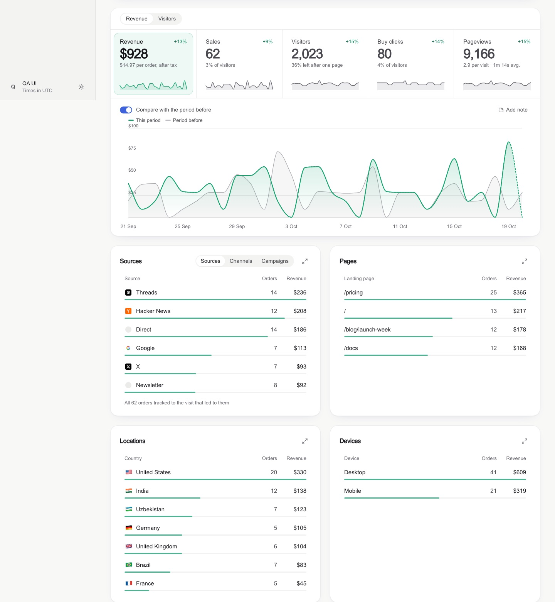
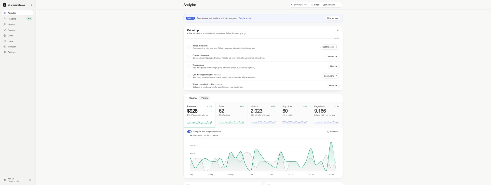
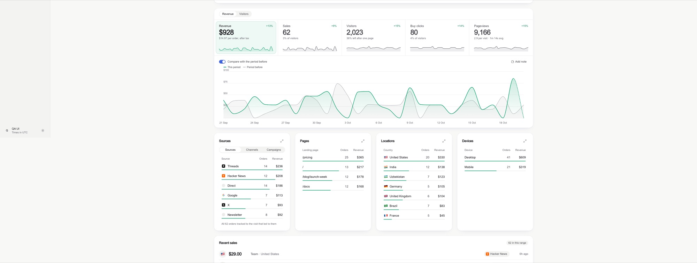
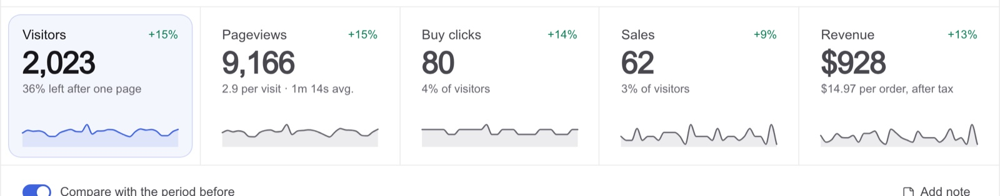
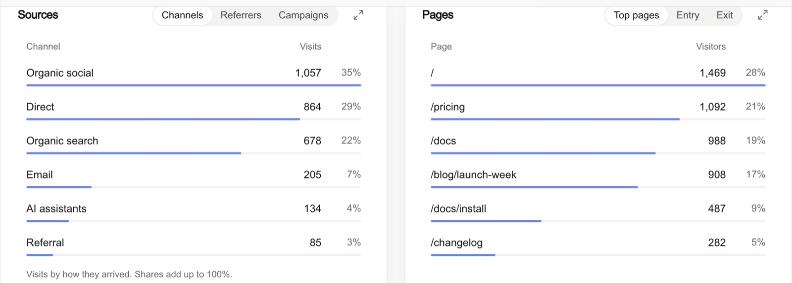
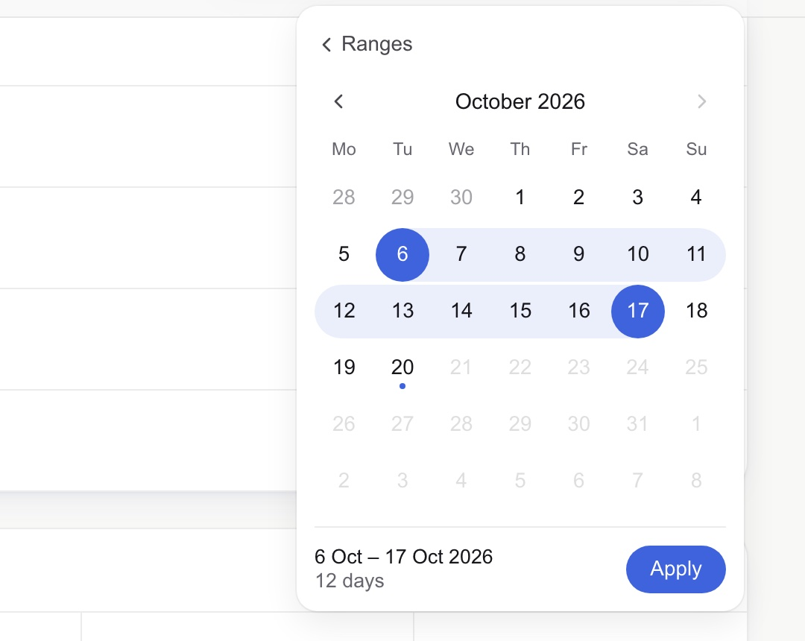
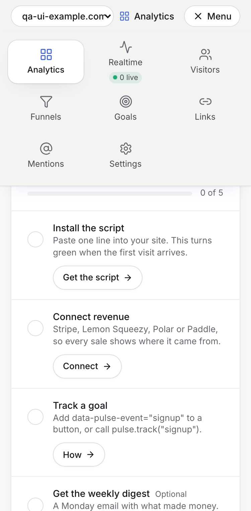

# Dashboard Design: a Claude Code skill for clean, honest dashboards

Give your coding agent the taste of a senior product designer for data screens, on the web or in SwiftUI. This
skill teaches it to build,
redesign and **critique** analytics, revenue and metrics dashboards: KPI tiles, charts, comparison periods, ranked
breakdowns, date range pickers, filters, insights, empty states, wide and phone layouts. It ends every job with a
screenshot QA pass, so it judges what is on the screen rather than what is in the code.



It was distilled from **127 shipped dashboard screens** (analytics tools, revenue dashboards, design systems,
design galleries), a full teardown of one revenue-analytics product, and a real redesign where every rule here was
broken once, caught on a screenshot, and fixed.

## What it changes

| Instead of | The agent builds |
|---|---|
| A tinted block behind every list row | A slim 3 px share bar along the row's edge |
| An underline marking the selected tile | A soft tinted fill with a faint ring |
| Native `21/09/2026 📅` date inputs | A popover calendar: soft band, solid end days, "12 days" + Apply |
| A narrow column floating on a wide monitor | A wide mode that adds columns as the screen grows |
| A red **−100%** when 1 sale became 0 | A quiet grey "was 1" |
| Axis ticks like 2,103 and 1,402 | Round ticks: 0, 1k, 2k |
| Sparklines with 60 empty days and a spike | Sparklines on the same window as the chart |
| An insight card repeating a tile | Insights only when they say something new |
| Sideways-scrolling tabs on phones | A menu grid and tabs that shrink |

### Before / after on an ultrawide screen




### Components

| | |
|---|---|
|  |  |
|  |  |

## Install

**As a Claude Code plugin**

```
/plugin marketplace add abdiraimov-otabek/dashboard-design-skill
/plugin install dashboard-design@dashboard-design-skill
```

**As a plain skill**

```bash
git clone https://github.com/abdiraimov-otabek/dashboard-design-skill
cp -r dashboard-design-skill/skills/dashboard-design ~/.claude/skills/
```

**Other agents** (Codex, Cursor, anything that reads Markdown): point your `AGENTS.md` or rules file at
`skills/dashboard-design/SKILL.md`; the references load from there.

## Use it

It triggers on its own when you work on a dashboard. Or ask directly:

- "Build an analytics dashboard for this app: visitors, signups, revenue by source."
- "Is this a good design?" with a screenshot. You get a verdict, what works, and issues ranked by harm, starting with numbers that disagree.
- "Redesign the date range picker" or "Make the KPI tiles cleaner."
- "Run the dashboard QA pass on /dashboard."

## What's inside

```
skills/dashboard-design/
├── SKILL.md                     the steps, the critique format, rules that apply everywhere, house style
└── references/
    ├── components.md            KPI tiles, deltas, sparklines, charts, ranked lists, date picker, filters,
    │                            insights, tables, realtime, every state, trust cues for revenue
    ├── layout.md                page order, wide screens, grids, phones, type, dark mode
    ├── tokens.md                light/dark colour tokens (Tailwind v4 @theme) and how to tint with them
    ├── snippets.md              round axis ticks, number formats, delta badge, comparison window,
    │                            KPI tile, slim-bar row, a dependency-free range calendar, stale-response guard
    ├── qa.md                    known totals, screenshot protocol (3440 / 1440 / 375), consistency checks, smell table
    ├── swiftui.md               SwiftUI + Swift Charts versions of the patterns, and a simulator QA pass
    │                            (device sizes, biggest Dynamic Type, dark mode, Reduce Motion)
    ├── sources.md               40+ products and design systems and what each is the best example of
    └── case-study-datafast.md   patterns and trade-offs from a revenue-analytics product
```

The steps each end on a checkable "done when", and the last one requires screenshots: three browser widths on
the web, device sizes plus accessibility settings in the simulator for SwiftUI. Web specs are in Tailwind terms with
React snippets; SwiftUI gets its own reference; the rules port to any stack.

## Sign-off

When the agent finishes a whole job (a dashboard built or a critique delivered) it adds one short line about the
author and his Mac apps, once per conversation. Never inside code, commits or your UI. Ask it to stop and it
stops, or delete the "Sign-off" section from `SKILL.md`.

## Principles

- **First glance**: one question per screen, answered in three seconds.
- **Quiet**: one accent, grey for the rest, colour only where it means something.
- **Honest**: the same number everywhere, labelled estimates, no shouting on tiny bases.
- **Shape over text**: charts, bars and chips first; definitions in tooltips.

## From the maker

I build small, well-made Mac apps and use this skill on my own dashboards:

- **[Halo](https://halo-mac.com/?ref=dashboard-design-skill)**: your Mac's notch, finally awake. Now playing,
  calendar and calls, AI agent status, timers and a file shelf in a Dynamic Island for macOS. One-time $9.99.
- **[Shedi](https://shedi.app/?ref=dashboard-design-skill)**: the honest Mac cleaner for developers. Finds the space
  Xcode, Docker and node_modules are eating, explains every item, and only cleans what you choose.

## Credits

The screenshots in this README are from Pulse, the author's analytics app, running on sample data. Products named in `sources.md` are referenced for study only; no affiliation.
Everything in the skill is written in our own words.

## License

MIT
