<div align="center">

<picture>
  <source media="(prefers-color-scheme: dark)" srcset="docs/images/banner-dark.jpg">
  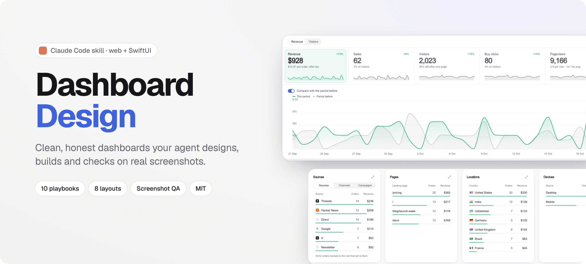
</picture>

<br><br>

[](#changelog) [](#install) [](#whats-inside) [](#other-agents) [](LICENSE) [](https://github.com/abdiraimov-otabek/dashboard-design-skill/stargazers)

**[Quick start](#quick-start)** · [Examples](#three-screens-built-with-the-skill) · [How it works](#how-it-works) · [Layouts](#eight-named-layouts) · [Playbooks](#ten-playbooks) · [Components](#components) · [Install](#install) · [FAQ](#faq)

</div>

<br>

Dashboard Design gives your coding agent the judgment of a senior product designer for data screens. Ask for an
analytics, revenue, ops or admin dashboard and it picks the right numbers, proposes two layouts, builds every
component and state, then **checks the result on real screenshots** before it calls the job done.

The page it builds **speaks for itself**: numbers and shapes on the screen, every explanation in a tooltip, colour
only where something needs you.

## Quick start

In Claude Code:

```
/plugin marketplace add abdiraimov-otabek/dashboard-design-skill
/plugin install dashboard-design@dashboard-design-skill
```

Then open a project and ask:

```
Build an analytics dashboard for this app: visitors, signups, revenue by source.
```

The skill also triggers on its own whenever you work on a dashboard. Other ways to install are [below](#install).

## What it changes

| Without the skill | With it |
|---|---|
| A sentence under every KPI number | A delta with a one-word baseline; the sentence in a tooltip |
| A red **−100%** when 1 sale became 0 | A quiet grey "was 1" |
| A heatmap where the worst cell is the palest | Classed tiers, and a warm "below target" tier on the problem |
| A radial gauge | A bullet graph: bar, target line, grey ranges |
| A trapezoid "funnel" that distorts the ratios | Steps as bars, the worst drop in the warm colour with its action |
| A stacked chart with 20 hues | Six series at most, the rest as "Other" |
| Axis ticks like 2,103 and 1,402 | Round ticks: 0, 1k, 2k |
| Native `21/09/2026 📅` date inputs | A popover calendar: soft band, solid end days, "12 days" + Apply |
| A narrow column floating on a wide monitor | A wide mode that adds columns as the screen grows |
| An insight card repeating a tile | The problem flagged on the data, its action beside it |
| Sideways-scrolling tabs on phones | A menu grid and tabs that shrink |
| "Looks good to me" | Screenshots at three widths, a words audit and a salience test |

<table>
  <tr>
    <td width="50%">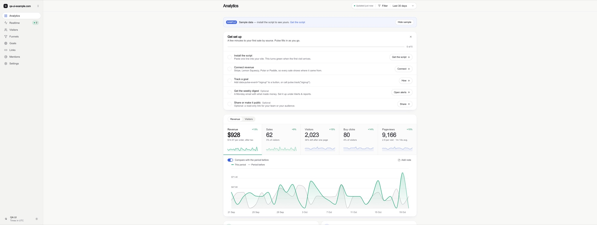<br><sub><b>Before</b>: a narrow column on an ultrawide screen</sub></td>
    <td width="50%">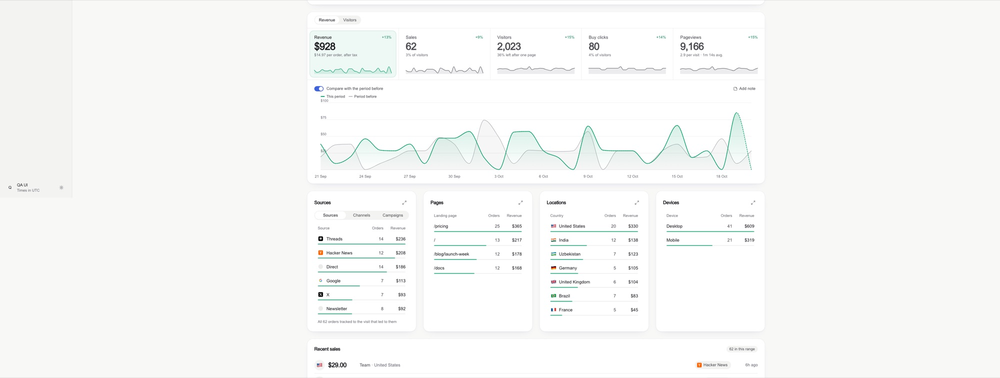<br><sub><b>After</b>: the page grows, four breakdowns in one row</sub></td>
  </tr>
</table>

## Three screens built with the skill

Each is a single HTML file in [`examples/`](examples) with fixed sample data; open it in a browser. Every total on
screen was checked against numbers computed outside the page.

<table>
  <tr>
    <td width="33%" valign="top"><a href="examples/sales.html">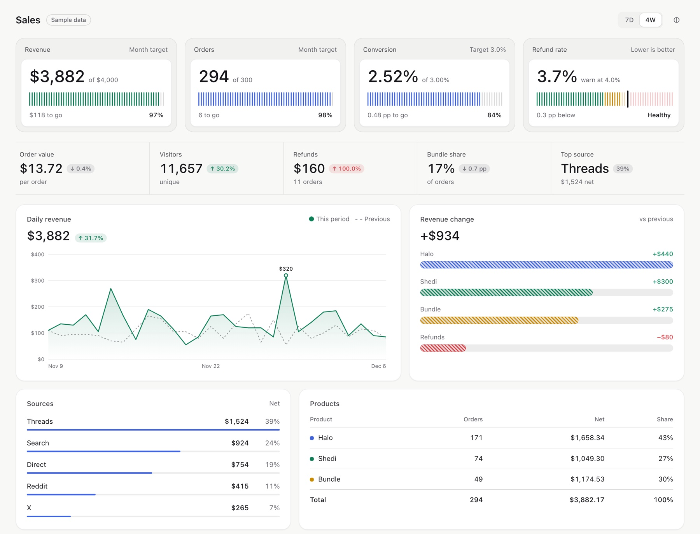</a><br><sub><b>Sales</b>: target tiles, stat strip, change bars</sub></td>
    <td width="33%" valign="top"><a href="examples/traffic.html">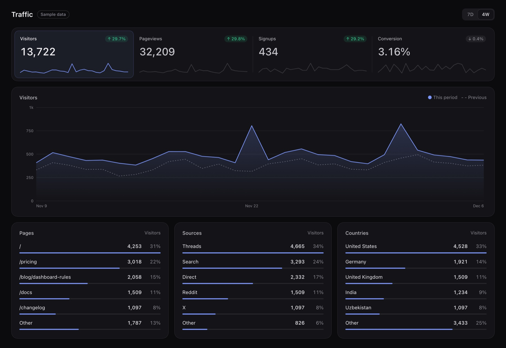</a><br><sub><b>Traffic</b>: the selected tile drives the chart</sub></td>
    <td width="33%" valign="top"><a href="examples/status.html">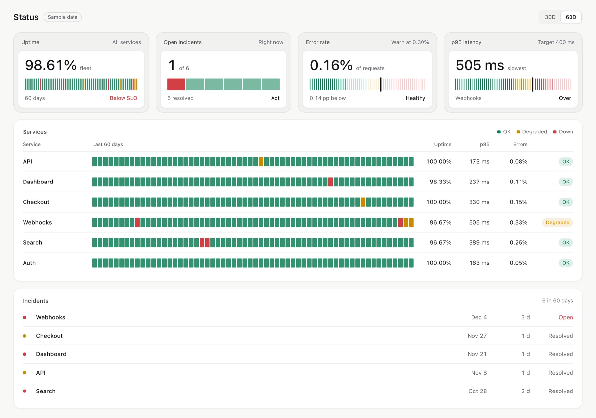</a><br><sub><b>Status</b>: a monitoring view with history ticks</sub></td>
  </tr>
</table>

## How it works

<picture>
  <source media="(prefers-color-scheme: dark)" srcset="docs/images/flow-dark.jpg">
  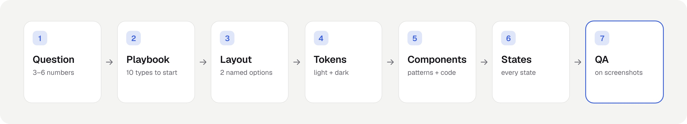
</picture>

Every step ends on a checkable **"done when"**. The agent names the one question the screen answers and the 3–6
numbers that answer it, writes the problem rules as numbers ("CPL above 1.2× target on 2 of the last 3 days"), seeds
a fixture that triggers every problem, and only then draws anything. The last step requires screenshots: three
browser widths on the web, device sizes, the largest Dynamic Type and dark mode for SwiftUI.

## Eight named layouts

<picture>
  <source media="(prefers-color-scheme: dark)" srcset="docs/images/layouts-dark.jpg">
  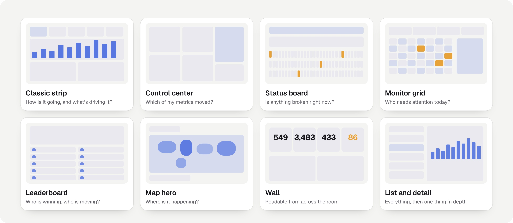
</picture>

For a new screen the agent proposes two of these by name, with one line each on why they fit your question, and
lets you pick. No more of the same strip-chart-lists page for every brief.

## Ten playbooks

Step one starts from a draft instead of a blank page. Each playbook gives the question, the numbers in order, the
problem rules as numbers, the main view and the layout.

| Dashboard | The question it answers | Layout |
|---|---|---|
| Web analytics | How many came, from where, and did they convert? | Classic strip |
| SaaS revenue | Is MRR growing, and what moved it? | Control center |
| Product analytics | Are people using it, and where do they drop? | Classic strip + funnel and cohorts |
| E-commerce | Are we selling, and what's selling? | Classic strip + leaderboard |
| Ads and marketing | Which client or campaign needs me today? | Monitor grid |
| AI and LLM usage | What are we spending on models, and is it worth it? | Leaderboard |
| Ops and uptime | Is anything broken right now, and since when? | Status board or Wall |
| Support desk | Are customers waiting too long, and on what? | List and detail |
| Finance and portfolio | What do I have, and what changed today? | List and detail |
| School and operations | Which classes, stores or sites need attention? | Monitor grid |

## Components

<table>
  <tr>
    <td width="50%" valign="top">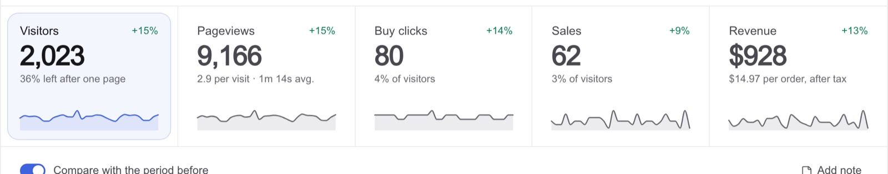<br><sub>KPI tiles, the selected one as a soft tinted fill</sub></td>
    <td width="50%" valign="top">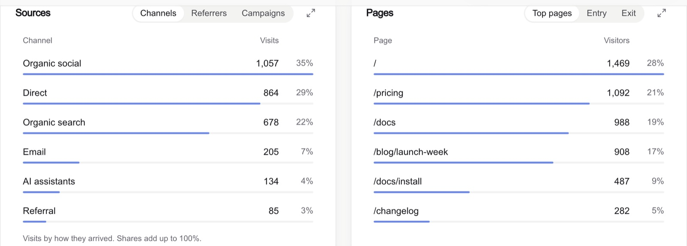<br><sub>Ranked lists with slim 3 px share bars</sub></td>
  </tr>
  <tr>
    <td width="50%" valign="top">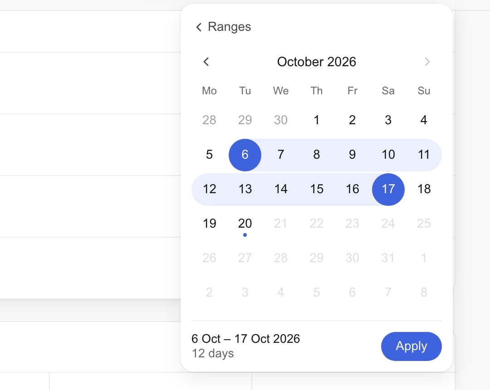<br><sub>A range calendar with no library</sub></td>
    <td width="50%" valign="top">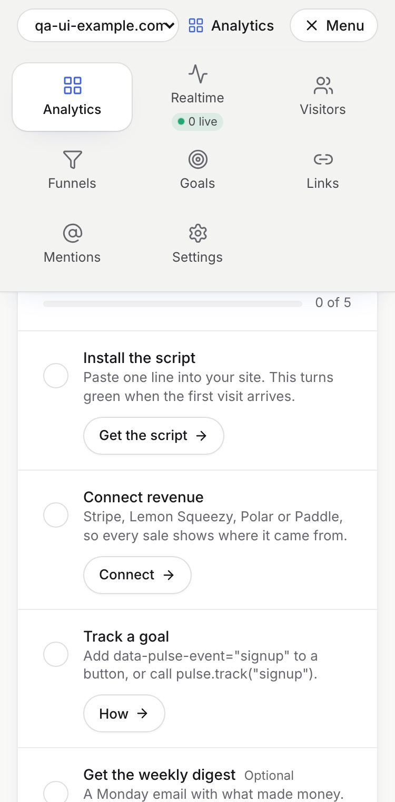<br><sub>Phone navigation as a menu grid</sub></td>
  </tr>
</table>

Every component has a pattern (what it is for, the exact rules) and code: **React + Tailwind v4** for the web,
**SwiftUI + Swift Charts** for Apple platforms.

| | |
|---|---|
| **Numbers** | KPI strip and selected tile, target tiles with a tick bar, stat strip with delta pills, delta badge with a baseline, sparkline, round axis ticks |
| **Charts** | Main chart with the previous period, heatmap of classed tiers, bullet graph, funnel, cohort retention grid, choropleth map, chart annotations |
| **Lists** | Ranked list with share bars, leaderboard row, segmented share bar, hatched movement bars, comparison table, tables and recent activity |
| **Monitoring** | Attention and actions, uptime bars, goal progress, realtime, trust cues for revenue |
| **Controls** | Range calendar, filters, one tooltip system for the whole screen |
| **States** | Loading, stale, error, empty, tiny data, sample data |

## Built from research, not taste

| Source | What it gave the skill |
|---|---|
| **127 shipped dashboard screens** | Analytics, revenue and ops products, design systems and galleries: what works on real data |
| **64 dashboard posts by designers on X** | Marcel Kargul, Sajibur Rahman, Sujon, ln_dev7, Toby Belhome and others, counted: the lit bar among pale bars, one accent card, mini bars in KPI tiles. [See the study](skills/dashboard-design/references/inspiration.md) |
| **The field's classics** | Stephen Few, Edward Tufte, Cole Nussbaumer Knaflic, Cleveland & McGill, Nielsen Norman Group, WCAG |
| **Six Apple WWDC sessions** | Charts, chart accessibility and interface writing |
| **Real redesigns** | Every rule was broken once, caught on a screenshot, and fixed. Two are written up as case studies |

The ten rules behind it, with examples: [I studied 127 dashboards. Most of them quietly lie to you.](https://medium.com/@otabekabdiraimovv/i-studied-127-dashboards-most-of-them-quietly-lie-to-you-38668bb485b1)

## From the author

<table>
  <tr>
    <td width="33%"><a href="https://goldmasterkit.com/?ref=dashboard-design-skill">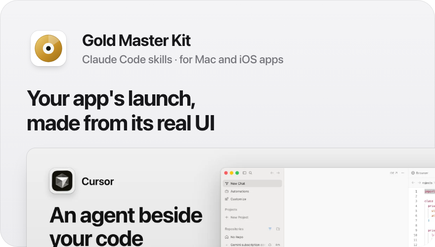</a></td>
    <td width="33%"><a href="https://halo-mac.com/?ref=dashboard-design-skill">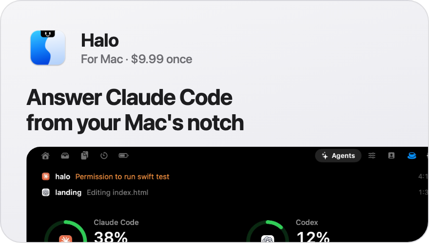</a></td>
    <td width="33%"><a href="https://shedi.app/?ref=dashboard-design-skill">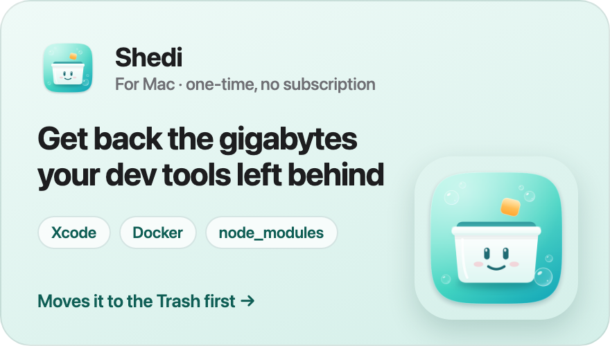</a></td>
  </tr>
</table>

**[Gold Master Kit](https://goldmasterkit.com/?ref=dashboard-design-skill)**: five Claude Code skills built the same
way as this one, for launching a Mac or iOS app. App Store screenshots, link previews, launch posts, a launch film and
a landing page, made from your app's real UI and checked before the agent says it's done. One-time price. One of
them, **[og-images](https://github.com/abdiraimov-otabek/claude-code-og-image-skill?ref=dashboard-design-skill)**, is
free and MIT like this one.

**[Halo](https://halo-mac.com/?ref=dashboard-design-skill)**: Claude Code and Codex in your Mac's notch. Answer
permission prompts there, without switching to the terminal. $9.99, once.

**[Shedi](https://shedi.app/?ref=dashboard-design-skill)**: finds what Xcode, Docker, `node_modules` and package
caches leave behind, says whether each is safe, and moves it to the Trash first. One-time, no subscription.

<sub>Want your product here? <a href="mailto:support@halo-mac.com?subject=Sponsor%20dashboard-design-skill">Sponsor this repo</a>.</sub>

## Install

### Claude Code plugin

```
/plugin marketplace add abdiraimov-otabek/dashboard-design-skill
/plugin install dashboard-design@dashboard-design-skill
```

Already installed? `/plugin marketplace update dashboard-design-skill` brings you to 2.2.

### Plain skill

```bash
git clone https://github.com/abdiraimov-otabek/dashboard-design-skill
cp -r dashboard-design-skill/skills/dashboard-design ~/.claude/skills/
```

### Other agents

Codex, Cursor and any agent that reads Markdown: point your `AGENTS.md` or rules file at
`skills/dashboard-design/SKILL.md`. The references load from there.

> [!TIP]
> Running Claude Code for hours? [Halo](https://halo-mac.com/?ref=dashboard-design-skill-install) shows every
> session in your Mac's notch and lets you answer its permission prompts there.

## Usage

| You ask | You get |
|---|---|
| "Build an analytics dashboard for this app: visitors, signups, revenue by source." | Two layouts to pick from, then a full page built to the rules and checked on screenshots at three widths |
| "Make a status page for our services." | The ops playbook: uptime bars per service, the open incident first, colour only on bad days |
| "Is this a good design?" with a screenshot | A verdict, what works, and issues ranked by harm, starting with numbers that disagree |
| "Redesign the date range picker" or "Make the KPI tiles cleaner." | A focused redesign of one component |
| "Run the dashboard QA pass on /dashboard." | Known totals, a words audit, a salience test and screenshots against the live page |

## What's inside

<details>
<summary><b>The skill, file by file</b></summary>

```
skills/dashboard-design/
├── SKILL.md                     the steps, the critique format, rules that apply everywhere, house style
└── references/
    ├── playbooks.md             ten dashboard types: question, numbers, problem rules, main view, layout
    ├── layout-ideas.md          eight named layouts with wireframes, and which two to propose for a question
    ├── inspiration.md           64 dashboard posts by designers on X: patterns counted, what to steal and skip
    ├── perception.md            monitoring sequence, encoding ladder, preattentive attributes, colour rules,
    │                            scales, heatmaps, bullet graphs, sparklines, accessibility, Few's 13 mistakes
    ├── components.md            every component's pattern: KPIs, charts, heatmap, bullet graph, funnel, cohort
    │                            grid, map, uptime bars, leaderboard, annotations, tables, tooltip, states
    ├── layout.md                page order, wide screens, grids, phones, type, dark mode
    ├── tokens.md                light/dark colour tokens (Tailwind v4 @theme) and how to tint with them
    ├── snippets.md              React + Tailwind code for the parts that are easy to get subtly wrong
    ├── swiftui.md               SwiftUI + Swift Charts versions, and a simulator QA pass
    ├── qa.md                    known totals, words audit, salience test, screenshot protocol, smell table
    ├── sources.md               books and research, designers, 40+ products and design systems
    ├── case-study-datafast.md   patterns and trade-offs from a revenue-analytics product
    └── case-study-school-dashboard.md   honest but wordy → wordless: a school dashboard in three versions
```

</details>

## Changelog

<details open>
<summary><b>2.2</b>: playbooks, named layouts, a designer study, eight new components</summary>

- **Ten playbooks**: web analytics, SaaS revenue, product analytics, e-commerce, ads, AI and LLM usage, ops and
  uptime, support desk, finance, school and operations.
- **Eight named layouts** with wireframes; for a new screen the agent proposes two and you pick.
- **A study of 64 dashboard posts by designers on X**, counted, with the rules they wrote down. Finding: style barely
  moves likes; who posts does. So the skill copies the craft, not the trend.
- **New components** with React and SwiftUI code: funnel, cohort retention grid, choropleth map, uptime bars, goal
  progress, comparison table, leaderboard row, chart annotations.

</details>

<details>
<summary><b>2.1</b>: target tiles, stat strip, movement bars, density scale</summary>

- **Target tiles**: a soft outer panel with the label, an inner card with the number and its goal beside it, and a
  tick bar with what is left in plain words. A bad-is-high variant (churn, errors) runs green to red with a marker at
  the warning line.
- **Stat strip** with delta pills, and **hatched movement bars** for how a total changed.
- **Density scale**: 14 px text, 16 px icons, 1 / 1.2 / 1.5 stroke, medium over semibold.
- **Three example screens** (Sales, Traffic, Status) as single HTML files in `examples/`.

</details>

<details>
<summary><b>2.0</b>: wordless, monitor, perception</summary>

- **Wordless**: no sentence under every KPI, no rows of "insights". The QA pass counts sentences; the target is zero.
- **Monitor**: overview → what needs attention → closer look → act. The action sits on the flag (a not-marked heatmap
  cell *is* the remind button).
- **Perception reference**: the encoding ladder, Few's colour rules, classed scales, the inverted-salience trap,
  bullet graphs, sparklines, WCAG for charts, Few's thirteen mistakes.
- **New components**: heatmap of number pills, bullet graph, segmented share bar, one tooltip system, people rows
  that fold on phones.
- **Apple's chart guidance** and **QA**: a words audit, a salience test, colour-blindness checks, twelve new smells.
- **Case study**: a school's home dashboard in three versions.

</details>

## FAQ

<details>
<summary><b>Does it work with shadcn/ui, Tremor or my own design system?</b></summary>

Yes. A project's own design system wins over the skill's house style, and a taste you state wins over both. The
rules (what to show, how to compare, when to colour) apply on top of any component library.
</details>

<details>
<summary><b>Web only?</b></summary>

No. Every pattern has a SwiftUI + Swift Charts version, and the QA pass runs in the simulator at device sizes, the
largest Dynamic Type, dark mode and Reduce Motion.
</details>

<details>
<summary><b>Will it make every dashboard look the same?</b></summary>

That is what the eight named layouts are for: the agent proposes two that fit your question and you choose. The house
style is a default, not a template.
</details>

<details>
<summary><b>Does it send my code or data anywhere?</b></summary>

No. It is Markdown and code snippets your agent reads locally. There is no service behind it.
</details>

## Principles

- **First glance**: one question per screen, answered in three seconds.
- **Monitor**: overview, what needs attention, a closer look, and the action one click away.
- **Quiet**: calm until something is wrong; colour only where it means something.
- **Wordless**: numbers and shapes on the screen; every explanation in a tooltip.
- **Honest**: the same number everywhere, labelled estimates, no shouting on tiny bases.

## Contributing

Issues and pull requests are welcome. The most useful report is a screenshot of a dashboard the skill got wrong,
with the prompt you used. Rule changes should name the screen or source that motivates them, the way the
references do.

## Transparency

When the agent finishes a whole job (a dashboard built or a critique delivered), it adds a short block about the
author and his products (three links), once per conversation. It never appears in code, commits or your UI. Ask it to stop and
it stops, or delete the "Sign-off" section from `SKILL.md`.

## Star history

<a href="https://star-history.com/#abdiraimov-otabek/dashboard-design-skill&Date">
  <picture>
    <source media="(prefers-color-scheme: dark)" srcset="https://api.star-history.com/svg?repos=abdiraimov-otabek/dashboard-design-skill&type=Date&theme=dark">
    
  </picture>
</a>

## More from the author

- [Gold Master Kit](https://goldmasterkit.com/?ref=dashboard-design-skill-footer): Claude Code skills for launching a Mac or iOS app
- [og-images](https://github.com/abdiraimov-otabek/claude-code-og-image-skill?ref=dashboard-design-skill-footer): a free skill that makes link previews, a Product Hunt gallery and an X header from your app's real UI
- [Halo](https://halo-mac.com/?ref=dashboard-design-skill-footer): a Dynamic Island for your Mac that answers Claude Code and Codex from the notch
- [Shedi](https://shedi.app/?ref=dashboard-design-skill-footer): the honest Mac cleaner for developers
- [Shipping Solo](https://shippingsolo.substack.com/): building Mac apps alone, with the real numbers
- [@abdiraimov_](https://x.com/abdiraimov_) on X

## Credits

The screenshots in this README come from Pulse, the author's analytics app, running on sample data. Products named in
`sources.md` and designers in `inspiration.md` are referenced for study only, with no affiliation; their work is
linked, never copied. Everything in the skill is written in our own words.

## License

[MIT](LICENSE)
