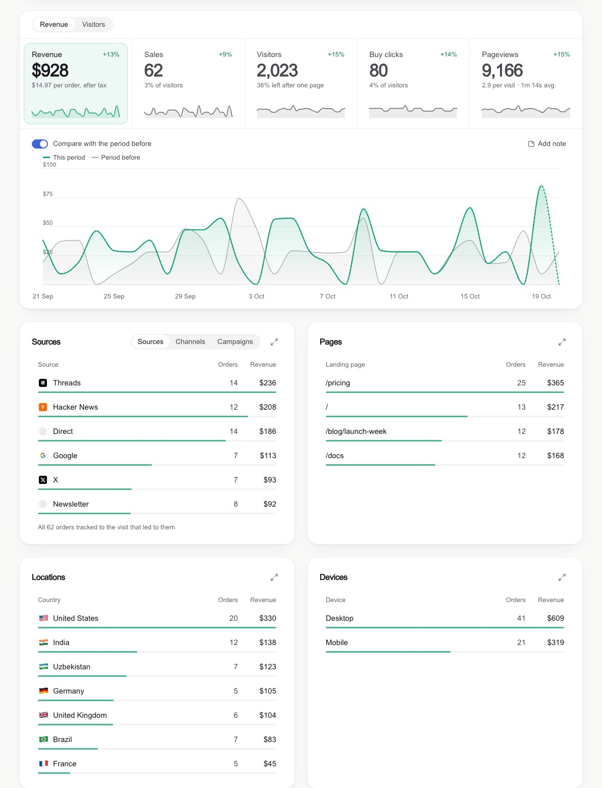
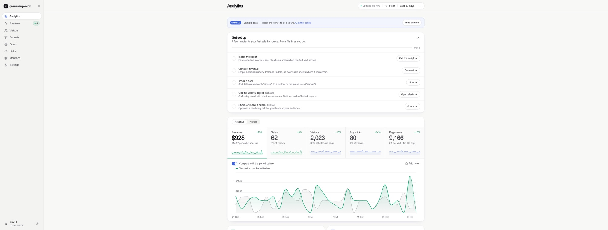
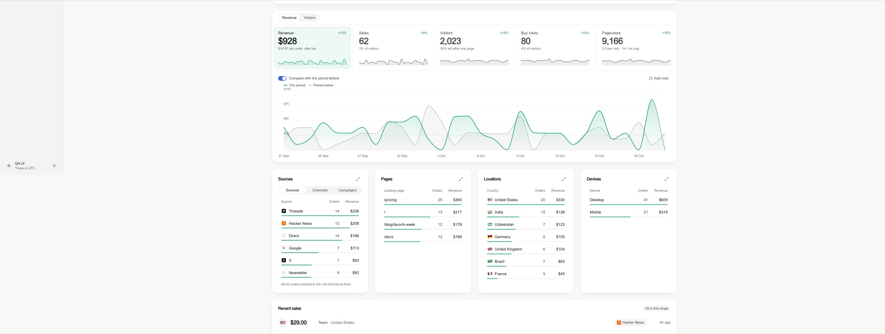
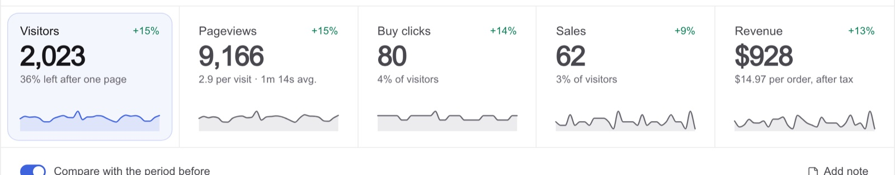
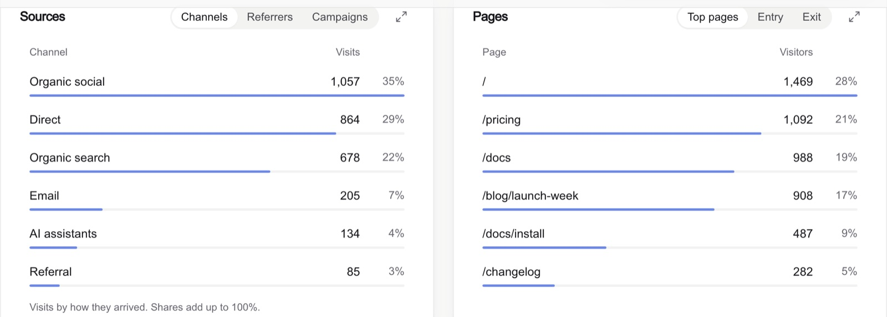
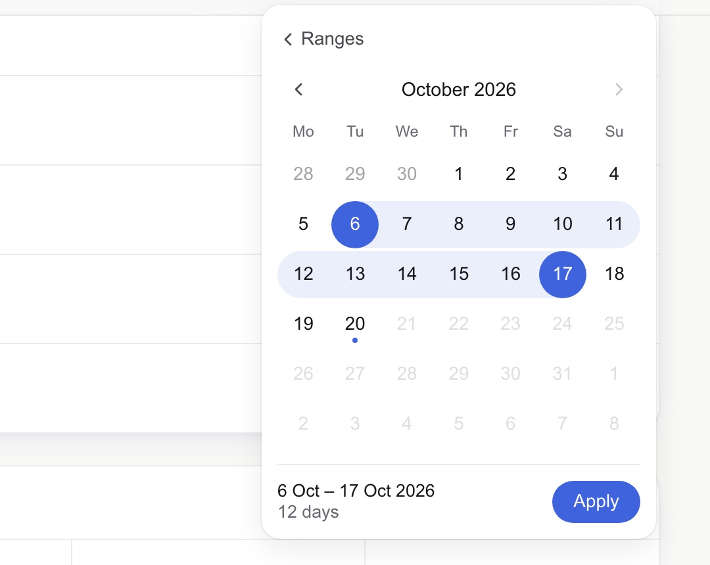
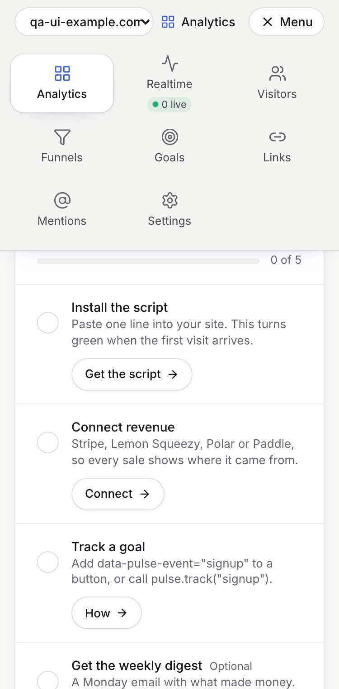

# Dashboard Design: a Claude Code skill for clean, honest dashboards

Give your coding agent the taste of a senior product designer for data screens, on the web or in SwiftUI. This
skill teaches it to build, redesign and **critique** analytics, revenue, metrics and admin dashboards: KPI cards,
charts, heatmaps, bullet graphs, comparison periods, ranked breakdowns, date range pickers, filters, empty states,
wide and phone layouts. Pages that **speak for themselves**: numbers and shapes on the screen, every explanation
in a tooltip. It ends every job with a screenshot QA pass, so it judges what is on the screen rather than what is
in the code.



It was distilled from **127 shipped dashboard screens** (analytics tools, revenue dashboards, design systems,
design galleries), the field's classics (**Stephen Few, Edward Tufte, Cole Nussbaumer Knaflic, Cleveland & McGill,
Nielsen Norman Group**, the WCAG), six of **Apple's WWDC sessions** on charts, chart accessibility and interface
writing, two full teardowns, and real redesigns where every rule here was broken once,
caught on a screenshot, and fixed.

## Sponsors

<table>
  <tr>
    <td align="center" width="33%">
      <a href="https://halo-mac.com/?ref=dashboard-design-skill"></a><br>
      <a href="https://halo-mac.com/?ref=dashboard-design-skill"><b>Halo</b></a><br>
      <sub>Your Mac's notch, finally awake: now playing, calendar, AI agent status, timers</sub>
    </td>
    <td align="center" width="33%">
      <a href="https://shedi.app/?ref=dashboard-design-skill"></a><br>
      <a href="https://shedi.app/?ref=dashboard-design-skill"><b>Shedi</b></a><br>
      <sub>The honest Mac cleaner for developers: Xcode, Docker, node_modules</sub>
    </td>
    <td align="center" width="33%">
      <a href="https://checkout.dodopayments.com/buy/pdt_0NqiETUgkTb8KOGcBgVqY?quantity=1"><b>Your logo here</b></a><br>
      <sub>Reach developers and designers who build dashboards with Claude Code</sub><br><br>
      <a href="https://checkout.dodopayments.com/buy/pdt_0NqiETUgkTb8KOGcBgVqY?quantity=1">Become a sponsor →</a>
    </td>
  </tr>
</table>

<p align="center">
  <a href="https://checkout.dodopayments.com/buy/pdt_0NqiETUgkTb8KOGcBgVqY?quantity=1"></a>
</p>

## New in 2.0

- **Wordless**: a sentence under every KPI and a row of "insights" sentences are gone. Numbers, shapes and
  one-word baselines on the screen; explanations in tooltips. The QA pass counts sentences; the target is zero.
- **Monitor**: overview → what needs attention → closer look → act. Problems are flagged on the data itself, and
  the action sits on the flag (a not-marked heatmap cell *is* the remind button).
- **Perception reference**: the encoding ladder, Few's colour rules, sequential / diverging / classed scales, the
  inverted-salience trap, bullet graphs, sparklines, WCAG for charts, Few's thirteen mistakes as a checklist.
- **New components**: heatmap of number pills with classed tiers, bullet graph, segmented share bar, one tooltip
  system, people rows that fold on phones instead of truncating.
- **Apple's chart guidance**: glance → interactive → expanded with continuity, fixed vs dynamic axes, gridlines at
  intuitive steps, spoken values context first, audio graphs, colours distinct by name, the words that remain
  (specific action labels, guiding empty states, errors with a fix).
- **QA**: a words audit, a salience test ("where does the eye land first?"), real-data and colour-blindness
  checks, and twelve new smells.
- **Case study**: a school's home dashboard in three versions, including the one its owner rejected for being a
  page of sentences.

## What it changes

| Instead of | The agent builds |
|---|---|
| A tinted block behind every list row | A slim 3 px share bar along the row's edge |
| An underline marking the selected tile | A soft tinted fill with a faint ring |
| Native `21/09/2026 📅` date inputs | A popover calendar: soft band, solid end days, "12 days" + Apply |
| A narrow column floating on a wide monitor | A wide mode that adds columns as the screen grows |
| A red **−100%** when 1 sale became 0 | A quiet grey "was 1" |
| Axis ticks like 2,103 and 1,402 | Round ticks: 0, 1k, 2k |
| Sparklines with 60 empty days and a spike | Sparklines on the same window as the chart |
| An insight card repeating a tile | The problem flagged on the data, its action beside it |
| A sentence under every KPI number | A delta with a one-word baseline; the sentence in a tooltip |
| A heatmap where the worst cell is the palest | Classed tiers and a warm "below target" tier |
| A radial gauge | A bullet graph: bar, target line, grey ranges |
| A card stretched half empty | Rows restructured so cards hold similar content |
| Sideways-scrolling tabs on phones | A menu grid and tabs that shrink |

### Before / after on an ultrawide screen




### Components

| | |
|---|---|
|  |  |
|  |  |

## Install

**As a Claude Code plugin**

```
/plugin marketplace add abdiraimov-otabek/dashboard-design-skill
/plugin install dashboard-design@dashboard-design-skill
```

**As a plain skill**

```bash
git clone https://github.com/abdiraimov-otabek/dashboard-design-skill
cp -r dashboard-design-skill/skills/dashboard-design ~/.claude/skills/
```

**Other agents** (Codex, Cursor, anything that reads Markdown): point your `AGENTS.md` or rules file at
`skills/dashboard-design/SKILL.md`; the references load from there.

## Use it

It triggers on its own when you work on a dashboard. Or ask directly:

- "Build an analytics dashboard for this app: visitors, signups, revenue by source."
- "Is this a good design?" with a screenshot. You get a verdict, what works, and issues ranked by harm, starting with numbers that disagree.
- "Redesign the date range picker" or "Make the KPI tiles cleaner."
- "Run the dashboard QA pass on /dashboard."

## What's inside

```
skills/dashboard-design/
├── SKILL.md                     the steps, the critique format, rules that apply everywhere, house style
└── references/
    ├── perception.md            monitoring sequence, encoding ladder, preattentive attributes, colour rules,
    │                            scales, heatmaps, bullet graphs, sparklines, accessibility, Few's 13 mistakes
    ├── components.md            KPI cards, deltas, sparklines, charts, ranked lists, date picker, filters,
    │                            attention and actions, heatmap, bullet graph, segmented bar, tables, tooltip,
    │                            realtime, every state, trust cues for revenue
    ├── layout.md                page order, wide screens, grids, phones, type, dark mode
    ├── tokens.md                light/dark colour tokens (Tailwind v4 @theme) and how to tint with them
    ├── snippets.md              round axis ticks, number formats, delta badge, comparison window,
    │                            KPI tile, slim-bar row, a dependency-free range calendar, stale-response guard,
    │                            heatmap tiers, bullet graph, segmented bar, one tooltip for the screen
    ├── qa.md                    known totals, words audit, salience test, screenshot protocol (3440 / 1440 / 375),
    │                            consistency checks, smell table
    ├── swiftui.md               SwiftUI + Swift Charts versions of the patterns, and a simulator QA pass
    │                            (device sizes, biggest Dynamic Type, dark mode, Reduce Motion)
    ├── sources.md               books and research, a designer, 40+ products and design systems
    ├── case-study-datafast.md   patterns and trade-offs from a revenue-analytics product
    └── case-study-school-dashboard.md   honest but wordy → wordless: a school dashboard in three versions
```

The steps each end on a checkable "done when", and the last one requires screenshots: three browser widths on
the web, device sizes plus accessibility settings in the simulator for SwiftUI. Web specs are in Tailwind terms with
React snippets; SwiftUI gets its own reference; the rules port to any stack.

## Sign-off

When the agent finishes a whole job (a dashboard built or a critique delivered) it adds one short line about the
author and his Mac apps, once per conversation. Never inside code, commits or your UI. Ask it to stop and it
stops, or delete the "Sign-off" section from `SKILL.md`.

## Principles

- **First glance**: one question per screen, answered in three seconds.
- **Monitor**: overview, what needs attention, a closer look, and the action one click away.
- **Quiet**: calm until something is wrong; colour only where it means something.
- **Wordless**: numbers and shapes on the screen; every explanation in a tooltip.
- **Honest**: the same number everywhere, labelled estimates, no shouting on tiny bases.

The ten rules behind the skill, with examples and before/after screenshots:
[I studied 127 dashboards. Most of them quietly lie to you.](https://medium.com/@otabekabdiraimovv/i-studied-127-dashboards-most-of-them-quietly-lie-to-you-38668bb485b1)

## Credits

The screenshots in this README are from Pulse, the author's analytics app, running on sample data. Products named in `sources.md` are referenced for study only; no affiliation.
Everything in the skill is written in our own words.

## License

MIT
